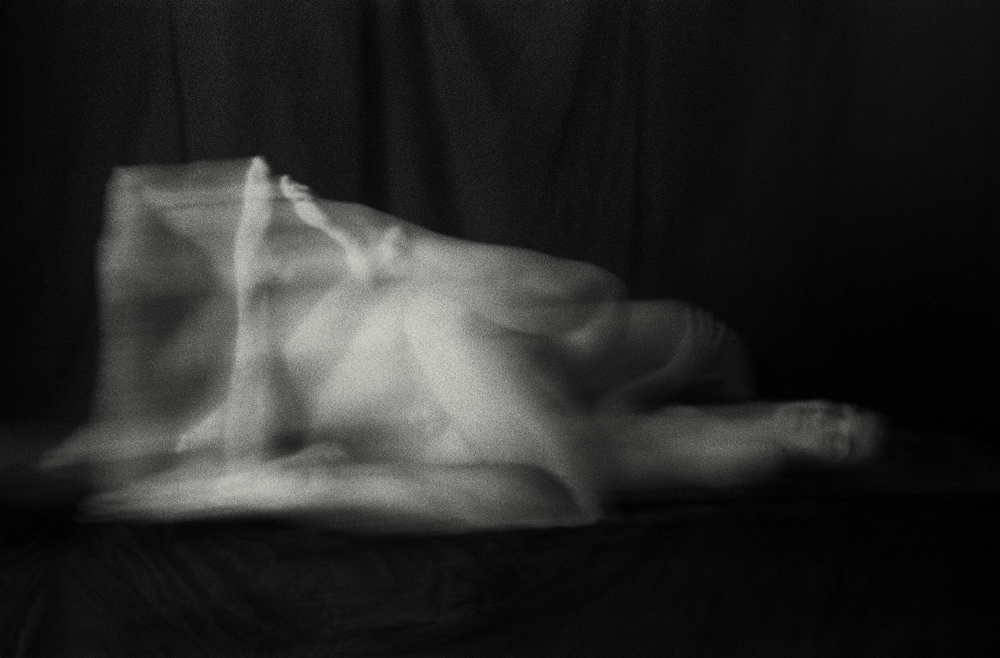
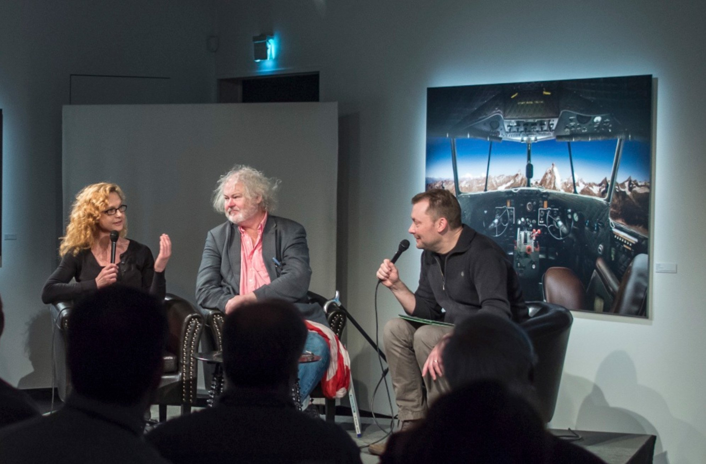

<iframe src="https://player.vimeo.com/video/588370641?h=4e33e0a276&app_id=122963" width="640" height="360" allow="autoplay; fullscreen; picture-in-picture" allowfullscreen></iframe>

*Intervju av Svenska Fotografers Förbund, 2021.*

18 augusti, 2021

# Stina Brockman

Stina Brockman (f.1951) hör till de konstnärer och fotografer som skapat sin egen personliga värld av uttryck och precision. Gemensamt för de flesta av Brockmans fotografier är att de löser upp skillnaden mellan yttre och inre verklighet. Hon är utbildad vid Konstfack och Kungl. Konsthögskolan.

Hennes verk har visats av Moderna Museet, Artipelag, Kulturhuset, Marabouparken och Hasselblad mfl. Det tyska förlaget Kehrer gav 2016 ut boken The Sensation of Falling. I filmen hör ni henne berätta om en spännande fotografisk resa.

Läs mer om Stina Brockman och hennes arbete [här](/).

Foto, ljud och redigering: Annika Thörn Legzdins.

Källa: [https://www.sfoto.se/fotoforfattarna-moter/stina-brockman/](https://www.sfoto.se/fotoforfattarna-moter/stina-brockman/)

*Yeah!*

20 januari, 2016

## Intervju med Stina Brockman på Konsthallen Hishult

“Den nya utställningen på Konsthallen i Hishult sätter den manliga kroppen i ett diffust fokus. Fotografen Stina Brockman rör sig med kameran och skapar bilder med en overklig prägel.
– Det är ett kul sätt att ta bilder och det blir en överraskning för mig också, säger Stina Brockman.
Kropparna får en genomskinlig kant och den oskärpan gör att de förefaller att röra sig.

– Jag har aldrig sett foto på det sättet, säger konsthallsbesökaren Bodil Svensson. Jag tycker att kropparna är sensuella och dansanta, att det är som en balett.”

*Källa: SR*

[Lyssna till intervjun på SR P4 Halland](https://sverigesradio.se/artikel/6349558)

*Samtal med Stina Brockman, Christer ”Fjellis” Fjellman och Göran på Fotografiska.*

7 mars, 2013

## Intervju med Stina och Fjellis

“För er som gärna vill lyssna på Christer ”Fjellis” Fjellman och Stina Brockman, men inte kunde ta er till Fotografiska i Stockholm – här kommer hela samtalet som podcast på Bildradion.”

*Källa:* http://bildradion.se/2013/03/07/avsnitt-44-goran-med-vanner-stina-och-fjellis/

[Lyssna till Avsnitt 44: Göran med vänner – Stina och Fjellis](http://bildradion.se/2013/03/07/avsnitt-44-goran-med-vanner-stina-och-fjellis/)
