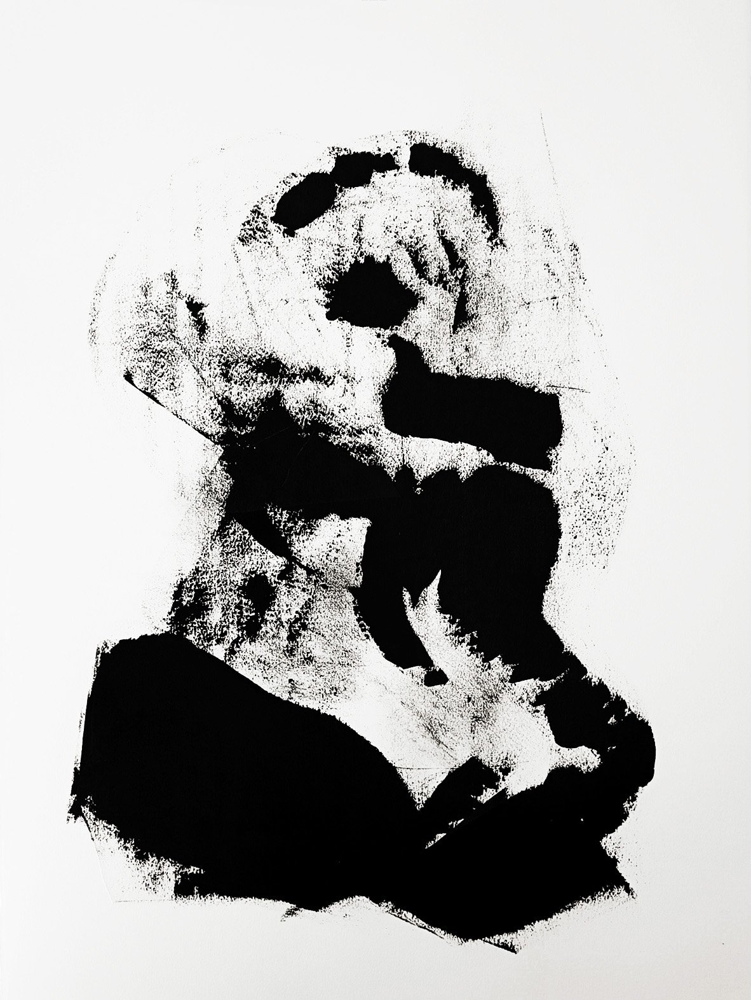
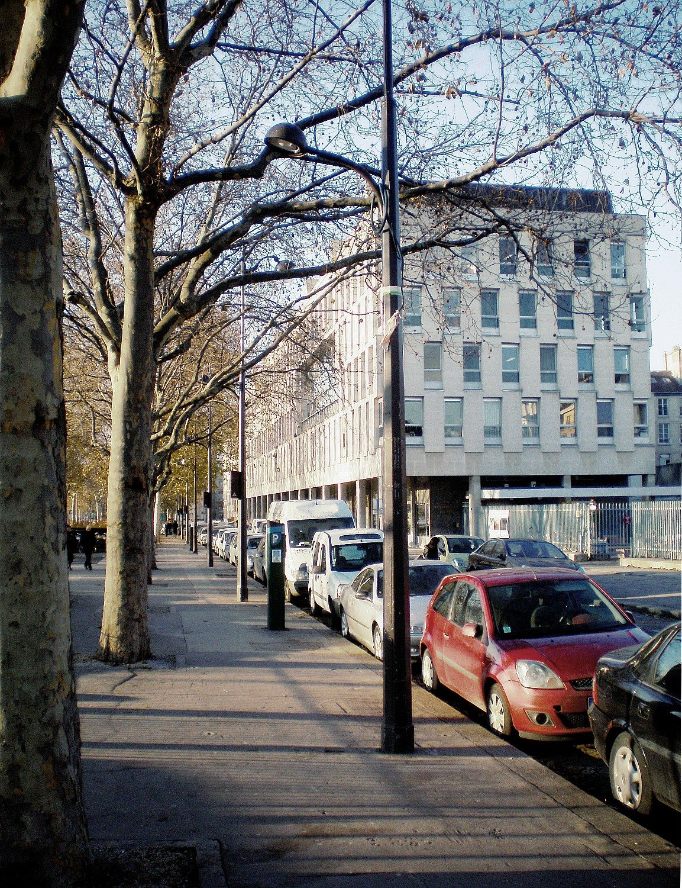
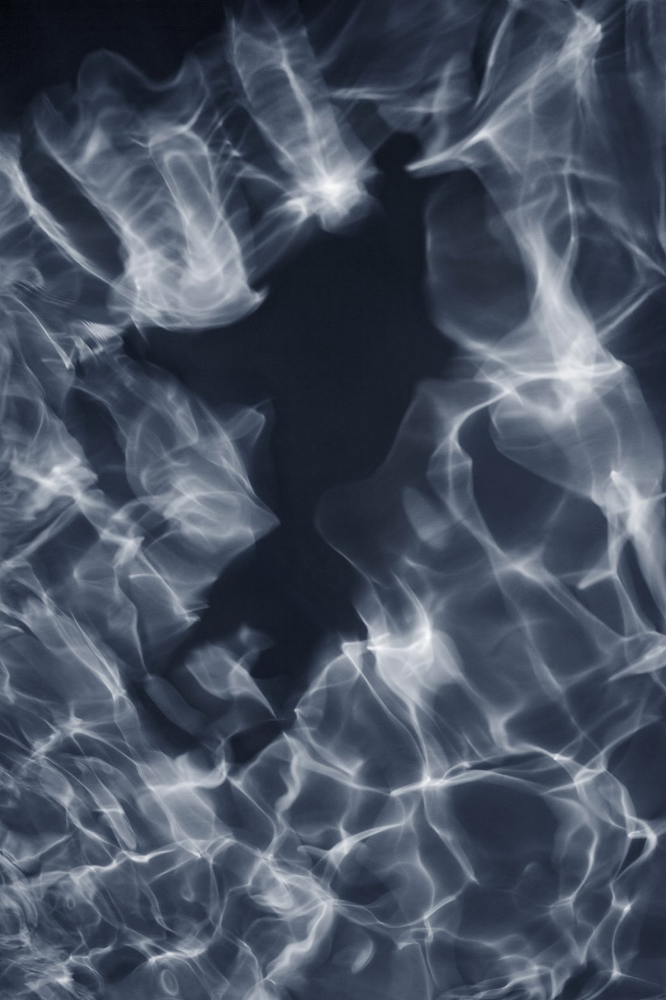
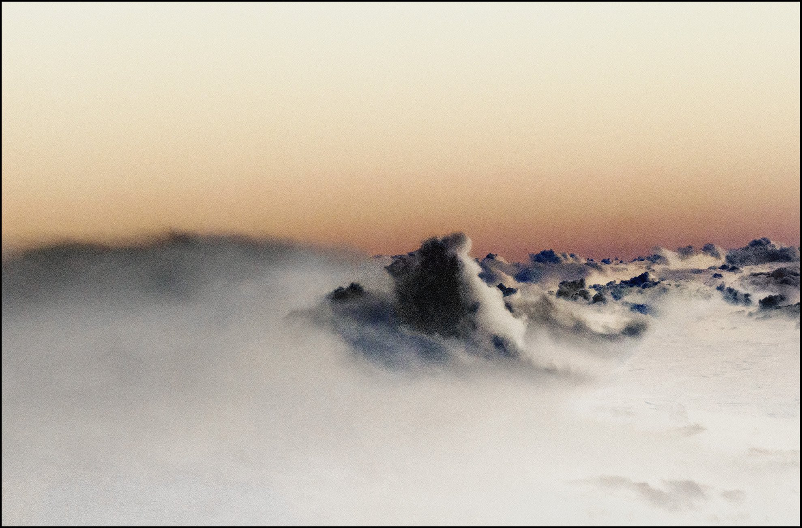
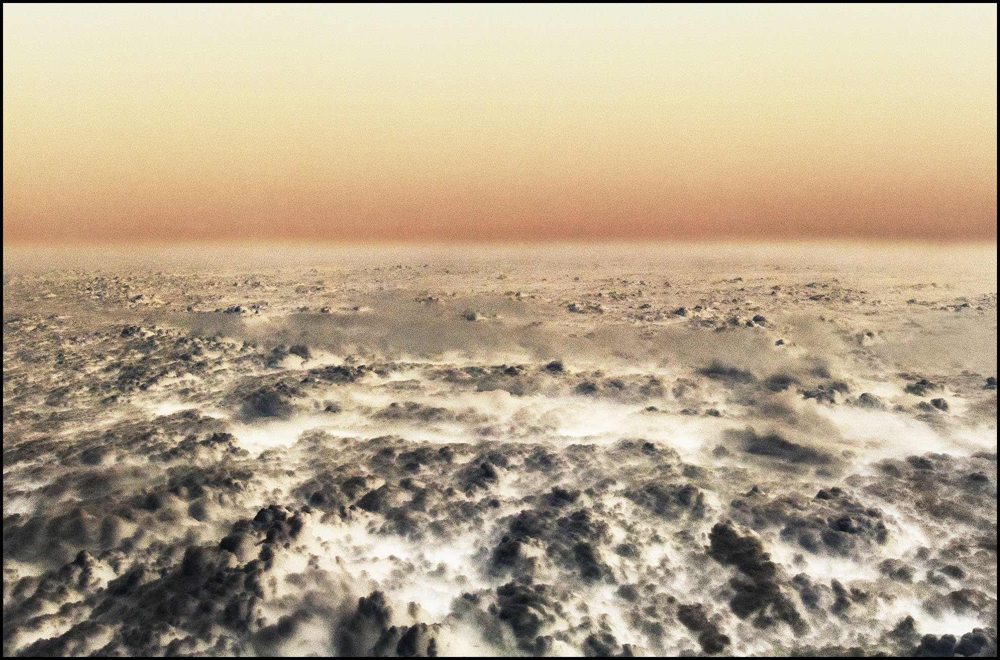
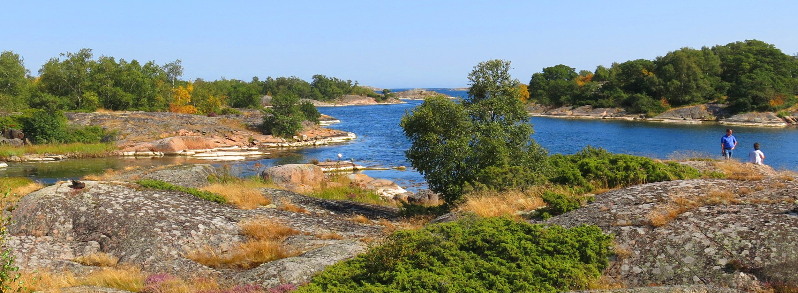
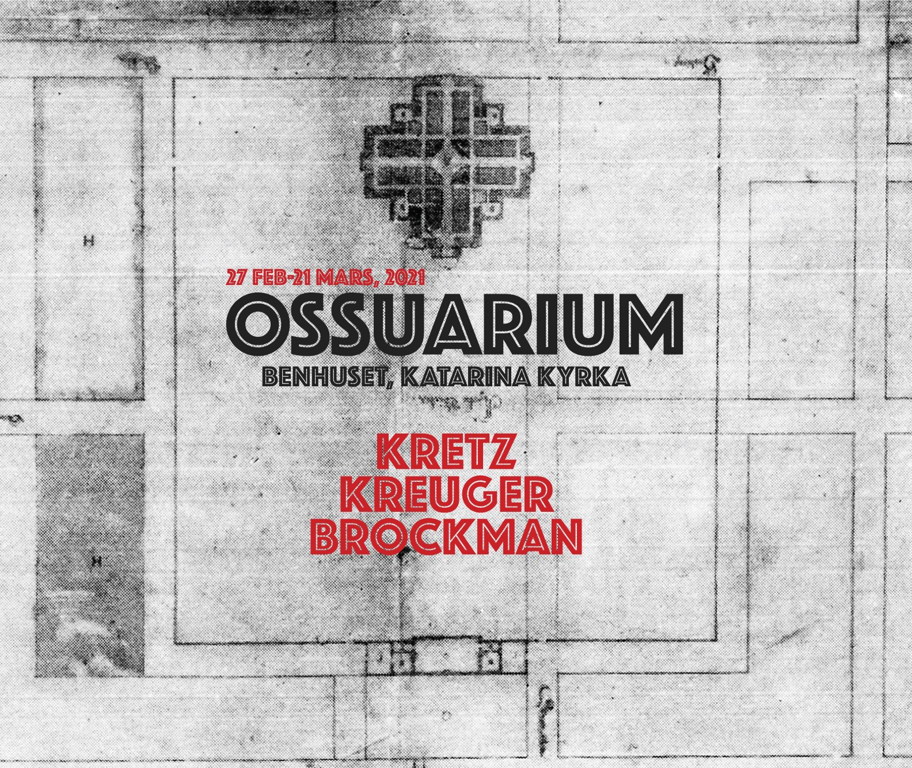
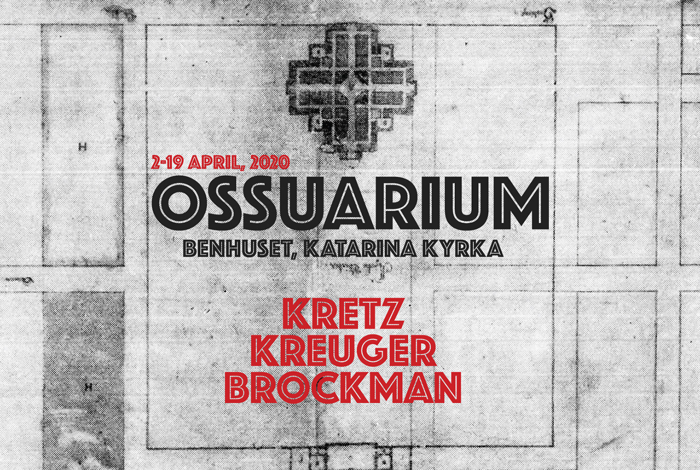

# S.o.T – State of Trauma

## Upcoming exhibition at Väst på fjället with Mari Kretz in October, 2024.

19th October – 3d November, 2024

### Opening 19th November, 2024 at Väst på fjället, Karlsbäck.

[Väst på fjället - hemsida](https://www.vastpafjallet.se/)

## Residency at Cité internationale des arts, Paris

May 3 - May 27, 2022
Cité internationale des arts, Paris

[Cité internationale des arts](https://www.citedesartsparis.net)

*Img source:* [*https//en.wikipedia.org*](https://en.wikipedia.org/wiki/Cit%C3%A9_internationale_des_arts)

## Inköpt av Moderna Museet 2021

Titel: "I Saw It" ur serien There You Are!

## Inköpt av Region Stockholm 2021

*Titel: I tid/ In Time*

*Titel: Lyssna/Listen*

## Axel Sjöberg Grant, residency at Långviksskär

Sommaren 2021
Runmarö, Stockholms län, 130 36 Sweden

[Runmarö](https://www.naturkartan.se/sv/varmdokommun/runmaro)

#### Vernissage 27 februari, 2021 i Benhuset, Katarina kyrka.

## Ossuarium - Kretz, Kreuger och Brockman

### Öppettider

**Öppning: Lördag den 27 februari kl 12-17**
Utställningen pågår 27 februari–21 mars, 2021.
Fredagar kl. 16-19
Lördag – söndag kl. 12–17
Finissage  Söndag 21 mars kl. 12-17

Benhuset vid Katarina kyrka, Stockholm.

2020

## Ossuarium

At Benhuset close to Katarina kyrka, Södermalm, Stockholm.
New works from Stina Brockman, Petter Kreuger och Mari Kretz.
From April 2-19 2020.
Open Thursday-Sunday kl. 12PM-5PM also during Easter.

2016

## Book release The Sensation of Falling at Kehrer Verlag Heidelberg

[*https://www.kehrerverlag.com/en/stina-brockman-the-sensation-of-falling-978-3-86828-693-9*](https://www.kehrerverlag.com/en/stina-brockman-the-sensation-of-falling-978-3-86828-693-9)

<iframe src="https://player.vimeo.com/video/171929318?h=715d73b554&app_id=122963" width="640" height="360" allow="autoplay; fullscreen; picture-in-picture" allowfullscreen></iframe>

“The Sensation of Falling contains nine series from 1980s to 2015 and focuses on human identity expressed through the body. Stina Brockman belongs to the group of artists who create a personal world of understanding. Her technical mastery, her integrity, and the deep emotional impact of her photographs are striking. She highlights what is hidden beneath what we call »normal.« She explores aspects of masculinity – somewhat obscure yet oddly revealed through attitudes and personal expression.”
