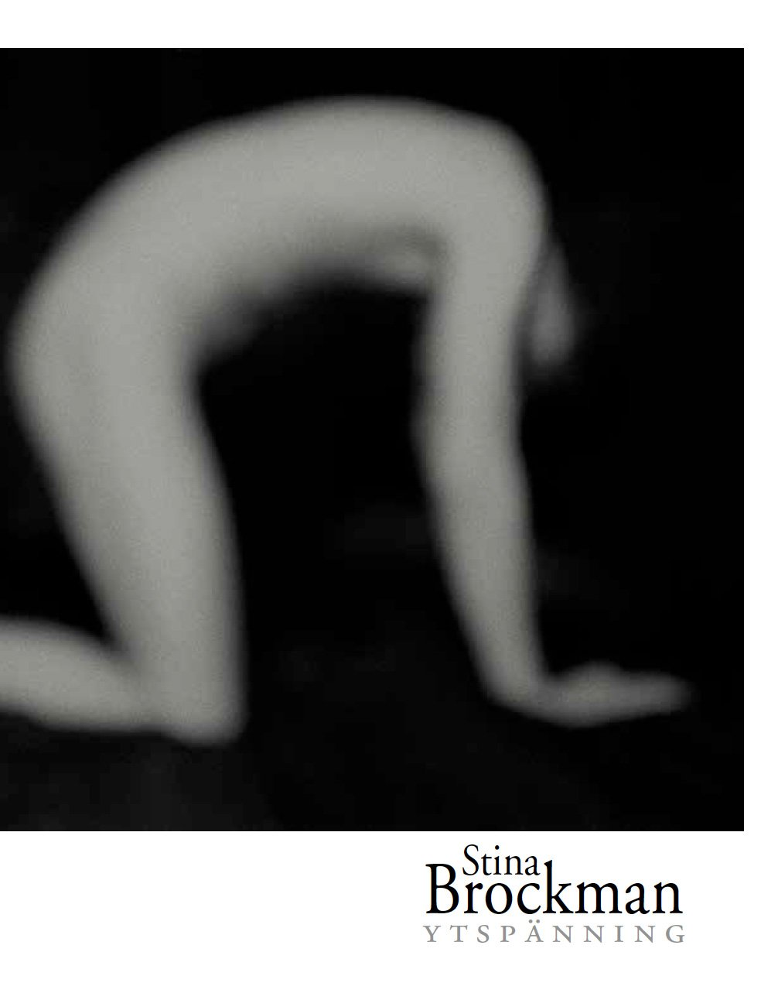
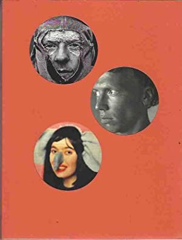

## Reviews

- ["There you are! - Stina Brockman", Kamera & Bild, 2016](https://www.kamerabild.se/node/545644)
- ["Storformat visas i konsthallen - Stina Brockman & Karin Bengtsson", Uppsala Nya Tidning, Maria Larsdotter, 25 november, 2016](https://unt.se/sigtunabygden/storformat-visas-i-konsthallen-4450845.aspx)
- ["Stina Brockman på Candyland", Northern Europe Art Today, 2 juni, 2014](https://northeurart.wordpress.com/2014/06/02/nuances-of-shadows-by-stina-brockman/)
- ["Stina Brockman på Candyland", Konsten, Jacob Anckarsvärd, 19 februari, 2014](https://konsten.net/stina-brockman-pa-candyland/)
- ["Stina Brockman - ser saker i ögonvrån", SvD, 18 oktober, 2008](https://www.svd.se/stina-brockman-ser-saker-i-ogonvran)
- ["Stinas bilder är öppna för tolkning", Dalarnas Tidning, Tobias Hedström, 11 augusti, 2005](https://www.dt.se/2005-08-11/stinas-bilder-ar-oppna-for-tolkning)
- ["Stinas bilder är öppna för tolkning", Fotosidan, David Elmfeldt, 27 juni, 2001](https://www.fotosidan.se/cldoc/news/stina-brockman-sexy-eyes.htm)

### Cataloges

- Stina Brockman - Ytspänning, Konsthallen i Hisshult, 2016, text av Erik Centerwall.

- Tre Fotografer. Tre Tendenser / Three Photographers. Three Trends. Marabouparken, 2012, text by Bettina Pehrsson, Konsthallschef/Director Marabouparken and Niclas Östlind. Part of the PhD-project Performing History. Photography in Sweden 1970 to the Present. University of Gothenburg.

- Stina Brockman, [Linkimage Art Edition](https://artedition.linkimage.com/photographers/stina-brockman/)

#### Stina Brockman - Ytspänning

Konsthallen i Hisshult, 2016, text av Erik Centerwall.
[*Ladda ner katalogen här.*](https://www.hishult.com/kataloger_2004_2015/2016/1_2016_StinaBrockman.pdf)
*Only available in Swedish.*

#### Tre Fotografer. Tre Tendenser / Three Photographers. Three Trends.

Marabouparken, 2012, text by Bettina Pehrsson, Konsthallschef/Director Marabouparken and Niclas Östlind.
Part of the PhD-project Performing History. Photography in Sweden 1970 to the Present. University of Gothenburg.

[*Ladda ner katalogen här / Download cataloge.*](https://gupea.ub.gu.se/bitstream/2077/31867/1/gupea_2077_31867_1.pdf)
*Text in Swedish and English.*
